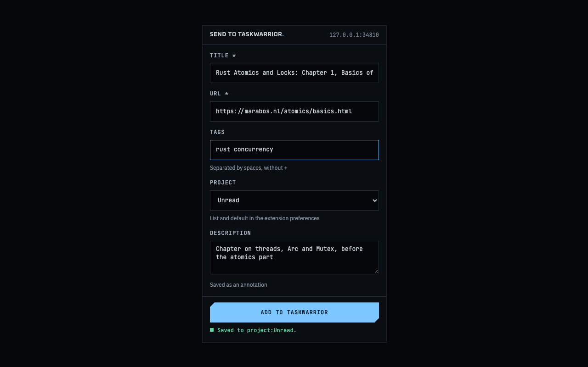

# Send to Taskwarrior Hardened

Save the current Firefox tab to [Taskwarrior](https://taskwarrior.org/) as a bookmark task, with
tags, a project and an optional note, from a toolbar button.

- **Extension**: [Send to Taskwarrior Hardened on addons.mozilla.org](https://addons.mozilla.org/firefox/addon/cb7d03e975ee4c8fad4b/)
- **Connector**: a small local daemon (`taskwarrior-connector`, Rust) that receives the tab from
  the extension and runs `task add`
- **Platforms**: Firefox on macOS and Linux (x86_64 and aarch64)



This is a hardened fork of
[shenlebantongying/Taskwarrior-Connector](https://github.com/shenlebantongying/Taskwarrior-Connector),
unmaintained since 2022. It is not compatible with the original add-on: see [Security](#security).

## Why Taskwarrior for bookmarks

Browser bookmarks are a folder tree with no dates and no state. Taskwarrior gives each link:

- tags and a project instead of a single folder, with Taskwarrior's full query language
- the date it was saved, and a done state once read, so old links stay searchable
- plain-text storage that is easy to back up and sync, and that works with any other CLI tool

## How it works

1. Click the toolbar button. The popup shows the tab's title and URL, plus tag, project and
   description fields.
2. The extension POSTs them to the connector on `127.0.0.1:34810`.
3. The connector runs, with an argument list and no shell:
   `task +tag1 +tag2 add "<title>" url:<url> project:<project>`, then
   `task <uuid> annotate -- "<description>"` when a description was typed, then `task sync` in
   the background (15 s timeout; harmless without a sync server).
4. The popup reports the result: saved, already saved (a URL saved before is not added twice),
   or the error returned by the connector.

## Installation

### 1. Taskwarrior

Install [Taskwarrior](https://taskwarrior.org/download/) and check that `task` works in a
terminal.

### 2. Connector

Pick one:

```bash
brew install alkaphreak/tap/taskwarrior-connector     # Homebrew, macOS and Linux
```

- Shell installer: `taskwarrior-connector-installer.sh` from the
  [latest release](https://github.com/alkaphreak/Taskwarrior-Connector/releases/latest), installs
  into `~/.cargo/bin`.
- From source: `cargo build --release` in this repository (binary in `target/release/`).

Then run the setup script for your platform from a clone of this repository:

| Platform | Setup                  | Removal                  | Runs as                                      |
|----------|------------------------|--------------------------|----------------------------------------------|
| macOS    | `./launchd_setup.bash` | `./launchd_cleanup.bash` | LaunchAgent `org.taskwarrior.connector`      |
| Linux    | `./systemd_setup.bash` | `./systemd_cleanup.bash` | systemd user service                         |

Each script declares the `url` UDA Taskwarrior needs (`task config uda.url.type string`, label
`URL`). Without it, no bookmark can be written and duplicate detection matches nothing. The
script then starts the connector in the background, using the binary found on `PATH`, else
`target/release/`. On macOS, launchd starts it at login and restarts it after a crash. On Linux,
the systemd user service starts with your session and is not restarted after a crash. Either
script is safe to re-run, for example after upgrading the binary.

### 3. Extension

- **Recommended**: install it from
  [addons.mozilla.org](https://addons.mozilla.org/firefox/addon/cb7d03e975ee4c8fad4b/). Firefox
  then updates it automatically.
- **Signed file**: download the `.xpi` from the
  [latest release](https://github.com/alkaphreak/Taskwarrior-Connector/releases/latest), then
  drag it into a Firefox window, or use `about:addons` > gear icon > "Install Add-on From File".
- **Development**: `about:debugging#/runtime/this-firefox` > "Load Temporary Add-on" >
  `firefox/manifest.json`. Firefox drops it at the next restart.

## Configuration

- **Projects**: `about:addons` > Send to Taskwarrior Hardened > Preferences. The first project in
  the list is the popup's default (`Links` out of the box). Project names match
  `[A-Za-z0-9._-]{1,64}`. The list is stored with `browser.storage.sync`, so it follows your
  Firefox account.
- **Tags**: separated by spaces in the popup, without `+` (the connector adds it).
- **Port**: the extension talks to `127.0.0.1:34810`. `taskwarrior-connector [port]` accepts
  another port, which is only useful for development, since the extension does not change its
  own.

## Usage

```bash
task project:Links list                      # bookmarks saved with the default project
task +rust list                              # by tag
task _get <id>.url | xargs open              # open a bookmark (macOS)
task _get <id>.url | xargs xdg-open          # open a bookmark (Linux)
task <id> done                               # mark it read, it stays searchable
```

See the [Taskwarrior documentation](https://taskwarrior.org/docs/) for filters, reports and sync.

## Security

The original daemon had three flaws, all fixed in this fork:

| Original behaviour                                                               | Risk                                                                    | This fork                                                       |
|----------------------------------------------------------------------------------|-------------------------------------------------------------------------|-----------------------------------------------------------------|
| Built a shell string from the page title and ran it with `os.system`             | Command injection from any page `<title>`                               | `task` runs with an argument list, no shell                     |
| Listened on every interface                                                      | Any device on the LAN could add tasks                                   | Binds `127.0.0.1` only                                          |
| Ran `task add` on a plain `GET`                                                  | Any web page could add tasks cross-origin (CSRF, no CORS preflight)     | `POST` only, with an `Origin: moz-extension://` header (403 otherwise) |

Other hardening:

- `task` gets a 10 s timeout, so a stuck process cannot hang the daemon.
- Errors come back as JSON, never as a silent failure.
- The project name is validated on both sides.
- Web pages cannot reach the connector, but any installed Firefox extension can, since all of
  them send a `moz-extension://` origin.

The extension asks only for `activeTab`, `tabs`, `storage` and `http://127.0.0.1/*`, and
collects no data.

## Development

```bash
cargo fmt --all --check && cargo clippy --locked --all-targets -- -D warnings && cargo test --locked   # connector, as in CI
cargo run -- 34811                                                             # connector on another port
npx web-ext@10 lint --source-dir=firefox                                       # extension, same version as CI
```

Everything under `firefox/` ships in the `.xpi`. The SVG icon masters live in `assets/`.
`AGENTS.md` lists the contracts between the popup and the connector. Bug reports and pull
requests are welcome on GitHub; the maintainer tracks planned work in a private YouTrack.

## Releasing

The extension and the connector share one version, and a single dispatch cuts a release:

```bash
gh workflow run bump-version.yml --repo alkaphreak/Taskwarrior-Connector -f bump=patch   # or minor, major, or -f version=X.Y.Z
```

- **`bump-version.yml`**:
  - sets the version in `firefox/manifest.json`, `connector/Cargo.toml` and `Cargo.lock`;
  - commits, tags `vX.Y.Z` and pushes;
  - dispatches `release.yml`.
  Never bump these files by hand.
- **`release.yml`**:
  - is generated by [dist](https://opensource.axo.dev/cargo-dist/) from `dist-workspace.toml`:
    edit the config and run `dist generate`, never the file;
  - builds the connector for the four targets;
  - publishes the GitHub Release (archives, checksums, shell installer);
  - pushes the Homebrew formula to `alkaphreak/homebrew-tap`;
  - calls `build-xpi.yml`.
- **`build-xpi.yml`**:
  - on a release, lints the extension and signs it on AMO (listed channel);
  - on a release, sends AMO release notes built from the `feat`/`fix` commit subjects since
    the previous tag (shown in `about:addons` > Release notes): write those subjects for users;
  - attaches the signed `.xpi` to the release;
  - a manual run (`workflow_dispatch`) builds `<version>.<run_number>` and signs it on the
    unlisted channel: never published on AMO nor auto-updated, the `.xpi` is a workflow
    artifact to install by hand.
- **`amo-listing.yml`** (manual dispatch, not part of a release): pushes the public AMO listing
  from the repo: name, summary and description in English and French plus homepage, support
  URL, categories and tags (`.github/amo-listing.json`), the icon (`firefox/icons/icon-128.png`)
  and the screenshots (`assets/screenshots/*.png`, rendered by `assets/screenshots/render.sh`).
  Run `gh workflow run amo-listing.yml --repo alkaphreak/Taskwarrior-Connector` after changing
  any of them. AMO caps writes per hour: if a run stops on that quota after the text and icon
  went through, rerun it later with `-f screenshots_only=true`.
- **`connector-ci.yml`**: runs fmt, clippy and the tests on pushes to `main` and on pull requests
  that touch the connector.

Recovery:

- If the tag was pushed but the dispatch failed, run
  `gh workflow run release.yml --ref vX.Y.Z -f tag=vX.Y.Z`.
- If AMO signing timed out (it runs last, after the release is public), do not re-run the job:
  the version is already uploaded and AMO rejects it a second time. Wait for AMO's approval,
  download the signed file from the AMO Developer Hub, then
  `gh release upload vX.Y.Z <file>.xpi`.
- If GitHub never acquires a `macos-15-intel` runner (the jobs are cancelled with "not acquired
  by Runner of type hosted"), register a temporary self-hosted Intel Mac runner with a custom
  label, point both macOS targets at that label in `dist-workspace.toml`, release, then revert
  and unregister it (done for 0.5.0). A self-hosted runner cannot reuse a hosted label.
  Make that switch before `bump-version.yml`: the release runs from the tag, so a runner
  change pushed to `main` afterwards is never seen, and the version cannot be bumped again.
- If AMO rejected the signing before the upload (the log shows no version ID, for example a
  400 on the metadata), re-running the failed `build-xpi` job is safe.
- AMO caps API writes per hour for the key shared by signing and `amo-listing.yml`: leave an
  hour between a listing run and a release.
- A bad version already on AMO cannot be rolled back: disable it in the Developer Hub and fix
  forward with a patch release.

## License

[GPLv3](LICENSE), like the original project by
[shenlebantongying](https://github.com/shenlebantongying/Taskwarrior-Connector).
